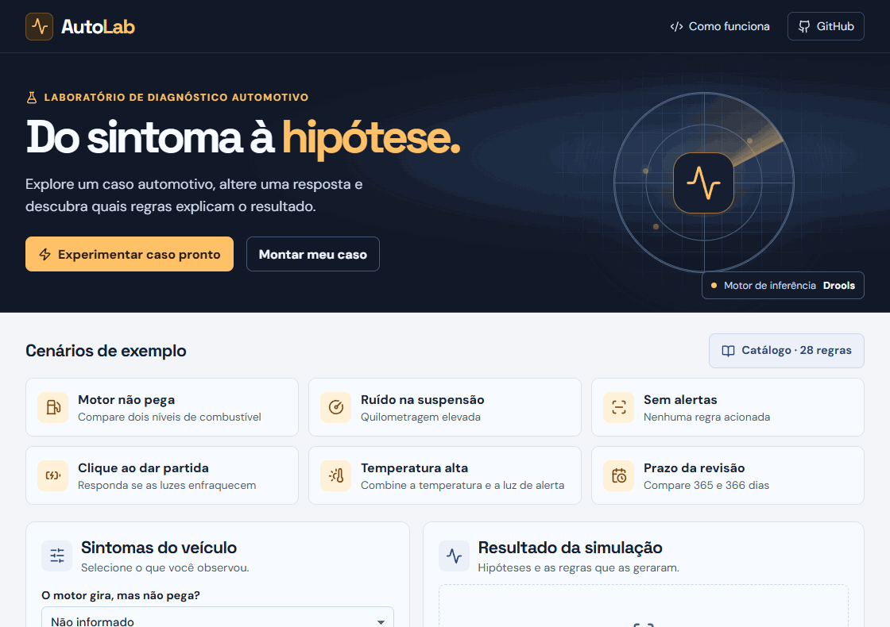

# AutoLab

Simulador educacional de diagnóstico automotivo com **28 regras Drools em seis áreas**. Altere os sintomas, veja quais evidências sustentam cada hipótese e compare duas simulações.

**[Testar a demo local](#rodar-localmente)** · [Publicar com Render](#publicar)



## Experimente em menos de um minuto

1. Abra **Clique ao dar partida**. O simulador pergunta se as luzes ficam fracas durante a tentativa.
2. Selecione **Não** e clique em **Aplicar e simular**. O painel **Antes e depois** mostra a nova hipótese de problema no circuito de partida.
3. Abra **Catálogo · 28 regras** para filtrar por área, examinar as condições e testar qualquer regra com dados de exemplo.

O cenário **Motor não pega** permite comparar dois níveis de combustível. **Prazo da revisão** mostra o limite didático de 365 dias e o resultado com 366 dias.

## Do terminal à web

```text
React + TypeScript → POST /api/diagnosticos → Spring Boot → Drools
                      ← hipóteses, regras e evidências ←
```

O projeto começou como um aplicativo de terminal. Agora, as [regras Drools](src/main/resources/regras/diagnostico.drl) retornam hipóteses com as evidências que as acionaram. O [serviço Java](src/main/java/com/example/sistemaespecialista/service/DiagnosticoService.java) usa uma sessão Drools por chamada. Os metadados das regras alimentam o catálogo e permitem sugerir perguntas quando falta uma única evidência para avaliar uma regra compatível com as respostas.

- `GET /api/regras` serve o catálogo, as condições, os exemplos e os campos do formulário.
- `POST /api/diagnosticos` executa a simulação e retorna as hipóteses e as perguntas de acompanhamento.

Os [testes de integração](src/test/java/com/example/sistemaespecialista/SistemaEspecialistaApplicationTests.java) exercitam cada uma das 28 regras com exemplos positivos, evidências ausentes e respostas que impedem seu disparo. Também cobrem hipóteses simultâneas, limites numéricos e as duas respostas do caso de acompanhamento.

## Rodar localmente

Com Docker:

```sh
docker build -t autolab .
docker run --rm -p 8080:8080 autolab
```

Abra [localhost:8080](http://localhost:8080/). React e a API são servidos pela mesma aplicação.

Para desenvolver com Java 17 e Node.js 22, execute `./mvnw spring-boot:run` na raiz e, em outro terminal, execute `npm ci` e `npm run dev` dentro de `frontend/`. Abra [localhost:5173](http://localhost:5173/). No PowerShell, use `.\mvnw.cmd spring-boot:run`. Para usar o modo terminal, execute o WAR com `--cli`.

## Publicar

O [Dockerfile](Dockerfile) empacota a interface e a API em uma única imagem. O [Blueprint do Render](render.yaml) configura o serviço web. A publicação requer acesso a uma conta do Render. Os visitantes podem usar a aplicação sem cadastro.

[](https://render.com/deploy?repo=https://github.com/MatheusSaleh/SistemaEspecialista/tree/portfolio/autolab)
